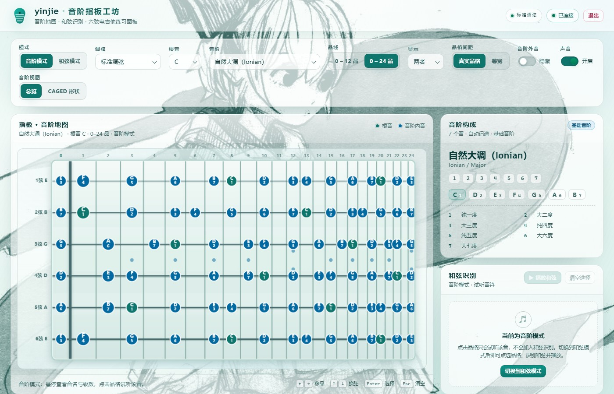
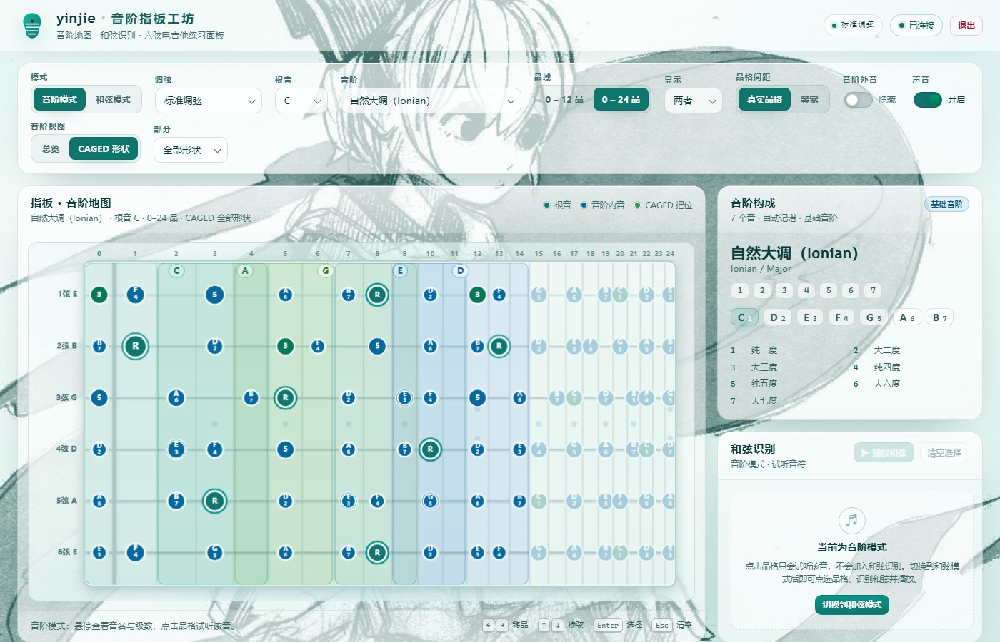
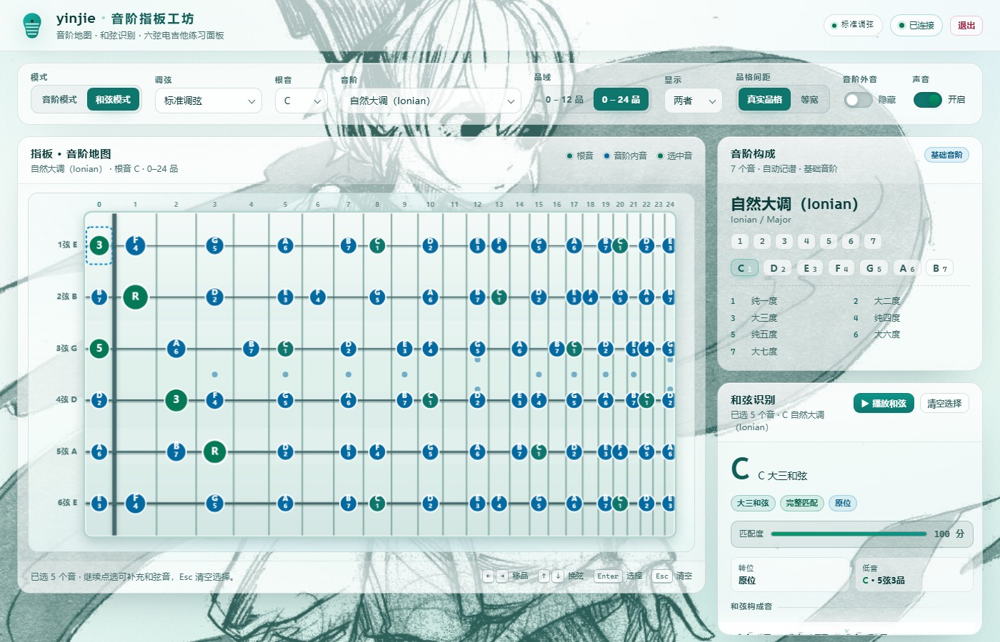
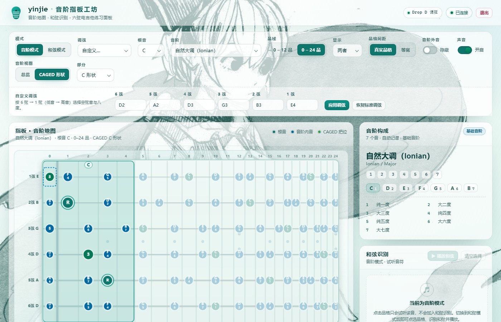
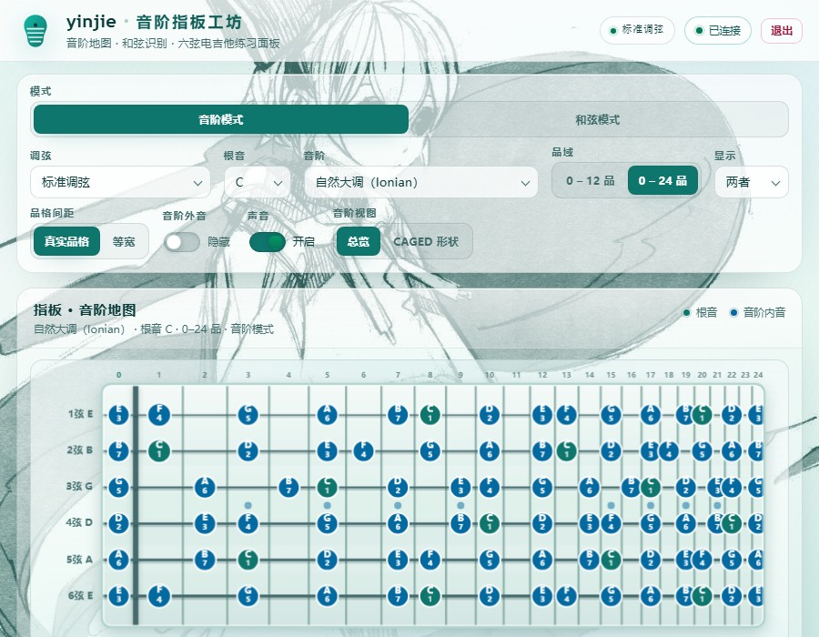

# yinjie · 音阶指板工坊

[](https://openjdk.org/)
[](https://spring.io/projects/spring-boot)
[](https://github.com/xiugudesu/-/actions)
[](https://github.com/xiugudesu/-/actions/workflows/ci.yml)
[](https://github.com/xiugudesu/-)

> 浏览器里的电吉他指板工具：**看音阶、练 CAGED、点品格识别和弦**。
> 仓库地址：<https://github.com/xiugudesu/->

**yinjie** 是一个用 **Java 21 + Spring Boot** 跑在浏览器里的电吉他工具：左侧是可切换调式/音阶的指板音阶地图（含 CAGED 把位图），右侧在指板上点选品格后**实时识别和弦**（根音、性质、转位、斜杠低音、缺失/额外音、替代和弦），并可一键扫弦试听。支持音阶/和弦两种模式、6 种常用调弦与自定义特殊调弦。

界面为原生 HTML/CSS/JavaScript（无任何 CDN 外部依赖），后端为 Spring Boot REST API，启动后浏览器访问即可使用。页面右上角的「退出」按钮可以关闭本地服务。

本工具的吉他乐理数据、指板几何绘制规则与交互方式，移植自早期的 Python/Tkinter 指板训练器原型；Web 版已完全独立，不再依赖任何外部项目或 Python 运行时。



<p align="center">
  <a href="docs/screenshots/02-caged-overview.jpg"></a>
  <a href="docs/screenshots/03-chord-identify.jpg"></a>
</p>
<p align="center">
  <a href="docs/screenshots/04-tuning-editor.jpg"></a>
  <a href="docs/screenshots/06-small-viewport.jpg"></a>
</p>

> 截图位于仓库 `docs/screenshots/`（JPEG），原始 PNG 与前端验收报告在 `verify/frontend-blue/`；发布包中不包含 `verify/`、`docs/screenshots/`。

**目录**：[功能](#功能) · [获取项目](#获取项目) · [快速开始](#快速开始) · [项目结构](#项目结构) · [REST API](#rest-api) · [构建与发布](#构建与发布) · [测试](#测试) · [更新日志](#更新日志)

## 获取项目

```bash
git clone https://github.com/xiugudesu/-.git yinjie
cd yinjie
```

也可以在仓库页面点 **Code → Download ZIP**；想要开箱即用的 Windows 发布包时，先按[快速开始](#快速开始)构建，再按[构建与发布](#构建与发布)生成 `dist/yinjie-1.0.0.zip`。

---

## 快速开始

环境要求：**JDK 21+**；从源码构建/运行还需要 **Maven 3.9+**。运行已构建好的 `target/yinjie-1.0.0.jar` 或发布包时**不需要 Maven**。用 `启动yinjie.bat` 启动时，若本机检测不到 Java，脚本会**自动下载 Eclipse Temurin / Microsoft OpenJDK 21 运行时**（约 45 MB，仅首次、需要联网）到同目录的 `runtime\jre21\`，不需要手动安装。

### 方式一：双击 `启动yinjie.bat`（Windows，推荐）

双击仓库根目录或发布包内的 `启动yinjie.bat`，脚本会：

1. 自动查找 Java：优先 PATH 中的 `java`，其次 `JAVA_HOME\bin\java.exe`、随包 `runtime\jre21\`，最后扫描 `C:\Program Files\Java`、Eclipse Adoptium、Microsoft OpenJDK、Amazon Corretto、Zulu 等常见安装目录；全部找不到时**自动下载 JRE 21 并解压到 `runtime\jre21\`**（约 45 MB，仅首次、需要联网，下载源依次为 Eclipse Temurin JRE/JDK 21、Microsoft OpenJDK 21），然后继续启动；
2. 检查 8090 端口：已有服务在运行则只打开浏览器，不重复启动；
3. 按布局选择 jar：发布包布局用同目录的 `yinjie.jar`，开发布局用 `target\yinjie-1.0.0.jar`；
4. 开发布局下比较 `src\main\java` 与 `target\classes` 的时间戳，必要时调用 `mvnw.cmd`（或系统 `mvn`）重新打包；
5. 启动服务并自动打开 <http://127.0.0.1:8090>。

> 脚本文件按中文 Windows 控制台的 ANSI（GBK）编码保存，避免 cmd 默认代码页 936 下中文乱码/语法错误。

### 方式二：Maven 直接运行

```bash
mvn spring-boot:run
```

### 方式三：打包后运行 jar

```bash
mvn -B package
java -jar target/yinjie-1.0.0.jar
```

浏览器打开：<http://127.0.0.1:8090>

默认只监听 `127.0.0.1:8090`（可在 `src/main/resources/application.properties` 修改端口）。开发前端时静态资源优先从 `src/main/resources/static/` 读取（`spring.web.resources.static-locations` 的第一项），改完刷新页面即可，无需重启后端。

---

## 功能

### 两种模式

- **音阶模式**（默认）：点击指板品格只发声、不加入和弦选择，用来查看音阶/CAGED 把位；点击不会把音阶音组合成和弦。
- **和弦模式**：点击品格加入/移出选择，实时调用后端识别和弦；只有这一模式能把选中的音组合成和弦，面板里提供「▶ 播放和弦」扫弦试听。


### 音阶查看器（指板地图）

- 6 弦，标准调弦 **E-A-D-G-B-E** 或任选调弦（见下），0–24 品；真实品格间距（十二平均律）或等宽两种画法。
- 17 种音阶/调式，按类别分组：
  - 基础音阶：自然大调（Ionian）、自然小调（Aeolian）、和声小调、旋律小调（上行）、和声大调
  - 教会调式：Ionian、Dorian、Phrygian、Lydian、Mixolydian、Aeolian、Locrian
  - 五声与布鲁斯：大调五声、小调五声、小调布鲁斯、大调布鲁斯
  - 特殊音阶：全音阶
- 14 种根音拼写（C…B，含 C#/Db、Eb、Gb、Ab、Bb 等），升降号随调式根音自动选择（F 大调显示 Bb，F# 大调显示 E#）。
- 指板显示模式：音名 / 级数 / 两者；根音高亮；可隐藏音阶外音（隐藏后仍可点击，用颜色区分）。
- 左侧弦标签（6 弦 … 1 弦）、品格号、3/5/7/9/12/15/17/19/21/24 品记（12/24 双点）。
- 音阶构成面板：级数公式、拼写后的音名、与根音的音程名称。

### CAGED 指板图

- 音阶模式下可切换「总览」或「CAGED 形状」。
- CAGED 形状可显示全部 5 个手型，也可只显示 C / A / G / E / D 中的某一个。
- 每个形状由后端按根音与调弦计算把位窗口：窗口外变暗、窗口内高亮音阶音，并标出该形状的根音/三音/五音，适合练习同一和弦的 5 个把位。


### 调弦（含自定义特殊调弦）

- 预设 6 种：标准 E-A-D-G-B-E、Drop D、降半音、DADGAD、Open G、Open D。
- 「自定义…」可逐弦选择音名+八度（6 弦→1 弦）构造任意特殊调弦，例如 `D2,A2,D3,G3,B3,E4`；应用后音阶地图、CAGED 图与和弦识别全部按新调弦计算。


### 点选识别和弦

- 鼠标点击任意品格切换选中；选中音会按当前音阶拼写出音名并标注和弦角色（根音/三音/五音/七音…）。
- 后端枚举 12 根音 × 24 种和弦性质评分，返回最合理和弦及最多 6 个替代候选：
  - 三和弦、七和弦、挂留、强力和弦、六和弦、加九、九和弦、6/9 等
  - 完整匹配 / 省略音（如省略五音的三和弦）/ 近似匹配
  - 原位与第一/第二/第三转位，低音非根音时给出斜杠和弦（如 `C/E`）
  - 缺失音与额外音提示、匹配度评分、中文说明
  - 命中常用开放/封闭把位指型时给出指型提示（如 `C 大三和弦开放把位（x32010）`）
- 「▶ 播放和弦」：按低弦→高弦扫弦试听当前识别出的和弦（WebAudio 合成，无音频素材）。
- 键盘操作：`←` `→` 移品、`↑` `↓` 换弦、`Enter`/`Space` 选择、`Esc` 清空。
- 可选 WebAudio 拨弦音效（点击品格/播放选中和弦）。

### 退出

页面右上角「退出」按钮：确认后调用 `POST /api/shutdown`，本地 Spring Boot 服务关闭，页面显示「服务已停止，可以关闭此页面」。

### 界面主题

- **浅色冰蓝 → 薄荷绿**配色：页面底色为很淡的冰蓝渐变，主强调色是 teal / emerald / sky，正文用深青；卡片与控件是半透明白面板（`rgba(255,255,255,.5–.66)`），在正文 ≥ WCAG AA 的前提下让背景画成块透出。
- 性能优先：为保证鼠标拖动/悬停顺滑（实测 60fps、无卡顿帧），前端**不使用 `backdrop-filter` 模糊和全页 `mix-blend-mode` 混合**（两者会让每次重绘触发大面积合成，实测帧间隔 59–64ms）；canvas 指板也不再给每个音名标记单独画阴影。样式改动前后的测量方法见 `verify/frontend-blue/perf-probe.mjs` 与前端验收报告。
- 背景画使用 `src/main/resources/static/img/muse.png`：由仓库 `background/20260110_003715.jpg` 处理得到的青绿线稿（透明 PNG），作为**全页固定背景层**放大铺满（`opacity .8` + 径向 mask 柔边），约 1/3 以上页面面积能直接看到线稿；纯装饰、不参与交互，打包后随静态资源内嵌进 jar，无外部图片依赖。
- 指板画布为浅薄荷琴板（`#e9f6f2`）+ 灰绿品丝 + 深青琴弦，与浅色页面协调；CAGED 五色使用 teal / emerald / lime / cyan / sky 600–700 系，图例与画布逐色一致。
- 纯原生 CSS，无 CDN、无外部字体；1400×900 与 900×700 两种窗口下均无横向滚动。

---

## 项目结构

```
yinjie/
├── .github/workflows/ci.yml         # GitHub Actions：JDK 21 上 mvn test + package
├── .gitignore / .gitattributes      # 忽略构建产物；锁定启动脚本的 GBK+CRLF 字节
├── pom.xml                          # Spring Boot 4.1.1 / Java 21
├── README.md                        # 本文件
├── 启动yinjie.bat                    # Windows 一键启动（找 Java / 端口预检 / 按需打包 / 启动）
├── docs/
│   ├── api.md                       # REST API 契约（前后端唯一权威文档）
│   └── screenshots/                 # README 界面截图（JPEG）
├── tools/
│   ├── needs-build.ps1              # 供 .bat 判断 jar 是否需要重新打包
│   ├── ensure-java.ps1              # 检测不到 Java 时自动下载 JRE 21 到 runtime/jre21/
│   └── build-dist.ps1               # 生成发布包 dist/yinjie/ 与 dist/yinjie-1.0.0.zip
├── runtime/                         # 首次用启动脚本自动安装的 JRE（约 45MB，不提交、可随删）
├── dist/                            # 发布产物（build-dist.ps1 生成，不提交、可随时重建）
├── background/
│   └── 20260110_003715.jpg          # 背景线稿原图（处理成 static/img/muse.png）
├── verify/                          # 交付前自检脚本、验收报告与证据日志（PNG 截图不提交）
└── src/
    ├── main/
    │   ├── java/com/yinjie/
    │   │   ├── YinjieApplication.java
    │   │   ├── theory/              # 音名/拼写、音阶目录、和弦性质目录、调弦、级数与音程
    │   │   ├── fretboard/           # 指板构造、品格音高、REST 视图模型
    │   │   ├── chord/               # 和弦识别评分器、常用指型库
    │   │   ├── caged/               # CAGED 5 个手型的把位窗口计算
    │   │   ├── dto/                 # JSON DTO（record）
    │   │   └── web/                 # ApiController / 异常处理 / 关闭服务
    │   └── resources/
    │       ├── application.properties
    │       └── static/              # index.html + css/app.css + js/app.js + js/audio.js + img/muse.png
    └── test/java/com/yinjie/        # 56 个 JUnit 5 测试（乐理/指板/调弦/CAGED/和弦识别/API）
```

## REST API

完整契约见 **[docs/api.md](docs/api.md)**。速览：

| 方法 | 路径 | 说明 |
| --- | --- | --- |
| GET | `/api/health` | 健康检查，返回 `{"app":"yinjie","status":"ok"}` |
| GET | `/api/options` | 根音、音阶目录、调弦预设（含 `defaultTuning`）、品格范围、默认值 |
| GET | `/api/fretboard?rootName=C&scaleId=major&fretFrom=0&fretTo=24&accidental=auto&tuning=E2,A2,D3,G3,B3,E4` | 指板每弦每品的音名/级数/是否在音阶内；`tuning` 省略即标准调弦 |
| GET | `/api/caged?rootName=C&scaleId=major&tuning=...` | CAGED 5 个手型的把位窗口、锚音、根音/三音/五音与窗口内音阶音 |
| POST | `/api/chord/identify` | 请求体 `{"positions":[{"string":1,"fret":3}],"scaleId":"major","rootName":"C","tuning":"D2,A2,D3,G3,B3,E4"}`（`string` 0=低 E 弦 … 5=高 E 弦，`fret` 0–24；`tuning` 可选），返回识别结果 |
| POST | `/api/shutdown` | 关闭服务（页面「退出」按钮调用），返回 `{"status":"shutting_down","message":"..."}` 后进程退出 |

`tuning` 参数格式：6 个「音名+八度」用英文逗号分隔，顺序为 6 弦→1 弦，例如 `E2,A2,D3,G3,B3,E4`；支持 `#`/`b`（也接受 `♯`/`♭`）。

示例：

```bash
curl 'http://127.0.0.1:8090/api/fretboard?rootName=F&scaleId=major&fretFrom=0&fretTo=12'

curl 'http://127.0.0.1:8090/api/caged?rootName=C&scaleId=major'

# Drop D 调弦下的 6/5/4 弦空弦 → D5 强力和弦
curl -X POST http://127.0.0.1:8090/api/chord/identify \
  -H 'Content-Type: application/json' \
  -d '{"positions":[{"string":0,"fret":0},{"string":1,"fret":0},{"string":2,"fret":0}],"scaleId":"major","rootName":"C","tuning":"D2,A2,D3,G3,B3,E4"}'
```

参数错误（含 JSON 语法错误、参数类型不匹配）返回 `400 {"error":"中文错误信息"}`；用错 HTTP 方法返回 405、Content-Type 不支持返回 415、未知路径返回 404，均为 JSON 体。

## 构建与发布

- **构建**：需要 JDK 21+ 与 **Maven 3.9+**（仓库根执行 `mvn -B package`，产物为 `target/yinjie-1.0.0.jar`）。构建产物（`target/`、`dist/`、`runtime/`）不提交到仓库，克隆后请自行构建；只想运行不打包时可直接 `mvn spring-boot:run`。
- **生成发布包**（PowerShell 7 或 Windows PowerShell 5.1）：

  ```powershell
  pwsh -NoProfile -File tools/build-dist.ps1
  ```

  脚本从仓库根读取 `target\yinjie-1.0.0.jar`（不存在则报错退出），清空并重建 `dist\yinjie\`，放入 `yinjie.jar`、`启动yinjie.bat`、`README.md`、整个 `docs\` 目录与 `tools\ensure-java.ps1`（自动下载 Java 用），然后生成 `dist\yinjie-1.0.0.zip`。脚本幂等，可重复执行；每次输出各步骤日志与最终文件清单。
- **发布包解压结构**：`yinjie-1.0.0.zip` 的根目录就是 `yinjie\` 文件夹（脚本用 `Compress-Archive -Path dist\yinjie` 打包），解压后得到 `yinjie\yinjie.jar`、`yinjie\启动yinjie.bat`、`yinjie\README.md`、`yinjie\docs\api.md`、`yinjie\tools\ensure-java.ps1`；双击 `启动yinjie.bat` 即可运行，无需 Maven、无需 `src/`（本机没有 Java 时首次启动会自动下载 JRE 21 到 `yinjie\runtime\jre21\`，约 45MB）。
- 当前内嵌静态资源以构建时的 `src/main/resources/static/` 为准；前端改动后需重新 `mvn -B package` 再跑一次 `tools/build-dist.ps1`。

## 测试

```bash
mvn -B test
```

覆盖（56 个）：音名解析与三度叠置拼写（F 大调 Bb / F# 大调 E#）、音阶公式拼写、音程命名、指板音高与弦序、调弦解析与校验（Drop D/DADGAD/降半音/升降号/自定义）、CAGED 5 个手型的把位与锚音、和弦识别（开放把位 C/Am/E/D7/A7/Cmaj7、强力和弦、斜杠和弦 C/E、Eb 调拼写、缺失/额外音、替代候选、参数校验）、MockMvc 的 REST 冒烟测试（options 调弦预设、fretboard 自定义调弦、CAGED、关闭端点），以及框架级客户端错误的状态码（畸形 JSON→400、错误方法→405、参数类型错误→400、未知资源→404）。

### 验证脚本（交付前回归，可选）

`verify/` 目录内置三个无第三方依赖的自检脚本：

```bash
# 1) REST API 全量冒烟：options 调弦预设、音阶拼写/格数/根音、常用指型识别、
#    6 种预设与自定义调弦、CAGED（顺序/锚弦/窗口/裁剪/F#/Drop D）、错误处理、静态首页
python verify/api-sweep.py http://127.0.0.1:8090

# 2) 真实浏览器交互：需要先用 --remote-debugging-port=9223 启动 Edge/Chrome 无头模式
node verify/cdp-check.mjs http://127.0.0.1:8090

# 3) 交互回归（模式门控 / CAGED / 调弦 / 播放 / 退出）；最后一步会真的停掉被测服务
node verify/cdp-v2-check.mjs http://127.0.0.1:8090
```

`cdp-check.mjs`／`cdp-v2-check.mjs` 需要先启动一个开了 CDP 端口的无头浏览器，例如：

```bash
msedge --headless=new --remote-debugging-port=9223 --user-data-dir=%TEMP%\yinjie-cdp --window-size=1600,1100 about:blank
```

`cdp-check.mjs` 会模拟真实鼠标点选 `x32010`、按 Esc、方向键+空格、切换调式/根音，断言和弦面板内容与 console 无错误，并输出截图与 `verify/cdp-report.json`。`cdp-v2-check.mjs` 覆盖音阶/和弦模式门控（音阶模式点击只试听、不组成和弦）、点选识别与播放和弦、CAGED 总览与单个形状、Drop D 调弦、自定义调弦编辑器，以及真实点击「退出」后后端停机，报告写入 `verify/cdp-v2-report.json`。

> ⚠️ `cdp-v2-check.mjs` 最后会真实调用 `POST /api/shutdown` 关闭被测服务，请勿对正在使用的服务运行，或运行后自行重启。

## 实现要点

- 音名/拼写：按「字母 + 升降号」三度叠置拼写，F 大调得到 Bb、F# 大调得到 E#，和弦音（如 Db7 的 Cb、Cdim7 的 Bbb）与音阶音都遵循调内拼写规则，避免仅按半音映射导致的 E#/F 混用。
- 指板几何：真实品格间距权重 `fret0 = (1-2^(-1/12))*0.72`、`fret n = 2^(-(n-1)/12) - 2^(-n/12)`，空弦列在琴枕左侧，12/24 品双点。
- 和弦识别：枚举 12 个根音 × 24 种和弦性质，按「构成音缺失/额外音/根音与低音是否在选中」评分，五音可省略（得到「省略音」匹配），低音不是根音时给出转位或斜杠和弦，并返回最多 6 个替代候选。
- 调弦：调弦用 6 个空弦 MIDI 音高表示（内部弦序号 0=6 弦 … 5=1 弦），品上音高 = 空弦 MIDI + 品；标准调弦下常用指型库给出指型提示，特殊调弦下只给理论分析。
- CAGED：以大三和弦的 5 个手型（C/A 锚 5 弦、G/E 锚 6 弦、D 锚 4 弦）为模板，把根音品 = (根音 pitch class − 锚弦空弦) mod 12 求出后整体平移，窗口取 [最小品−1, 最大品+1] 并裁剪到 0–24 品；窗口内按当前音阶着色。
- 关闭服务：`/api/shutdown` 先返回 JSON，再由后台线程调用 `SpringApplication.exit` + `System.exit`（约 0.5 秒），关闭逻辑封装为可 mock 的 bean，测试不会真的结束 JVM。

---

## 更新日志

### v1.0.2 — 2026-10-20（启动脚本自动安装 Java）

- 新增 `tools/ensure-java.ps1`：`启动yinjie.bat` 在本机检测不到 Java 时，自动从官方源（Eclipse Temurin JRE 21 → Temurin JDK 21 → Microsoft OpenJDK 21）下载约 45MB 的运行时，解压到 `runtime\jre21\` 后继续启动，全程无需管理员权限；已有 Java 或已下载过时直接复用；
- 下载优先用系统自带 `curl.exe`（`--fail --max-time 900`，实测 49MB 约 7–10 秒），老系统回退 `Invoke-WebRequest`；全部下载源失败时给出 Adoptium 手动下载地址；
- 发布包新增 `tools\ensure-java.ps1`，`build-dist.ps1` 同步拷贝并在 zip 结构自检中校验该条目；
- 实测：干净目录解压 zip 后强制走下载分支启动，自动安装 Microsoft OpenJDK `21.0.12.1` 到包内 `runtime\jre21\`，服务正常启动、`/api/health` 正常；二次启动直接复用已装运行时。

### v1.0.1 — 2026-10-20（性能与启动修复）

**性能优化（前端卡顿修复）**

- 移除 `css/app.css` 中 14 处 `backdrop-filter` 毛玻璃，以及 `.muse-decor` 的 `mix-blend-mode: multiply`（两者会让每次重绘触发大面积合成）；
- 移除 `js/app.js` canvas 指板逐音符 `shadowBlur`（仅保留琴板/琴枕 2 处单次阴影）；
- 实测鼠标悬停扫动帧间隔 **59–64ms（约 15fps、154–156 个 >32ms 卡顿帧）→ 稳定 16.7ms（60fps、0 卡顿帧）**；测量脚本 `verify/frontend-blue/perf-probe.mjs`；
- 回归全部通过：REST 冒烟 174 项、浏览器交互 13 + 26 项、主题专检 40 项；
- 视觉代价是失去「毛玻璃」观感，面板仍为半透明白、背景线稿更清晰。

**启动脚本修复（`启动yinjie.bat`）**

- 编码由 UTF-8 无 BOM 改为 **ANSI/GBK + CRLF**：修复中文 cmd（默认代码页 936）下 `if (...)`/`for (...)` 括号块被误读、报 `'R"' 不是内部或外部命令` 后闪退的问题；
- 修复 Java 检测逻辑 bug（原 `where java` 成功后仍用 `if not exist "java"` 把命令名当文件校验，导致误报「找不到 java」）；
- Java 查找顺序改为 **PATH → `JAVA_HOME\bin\java.exe` → 扫描 Program Files 常见 JDK 目录**（Java / Eclipse Adoptium / Microsoft / Amazon Corretto / Zulu / 32 位 Java），全部找不到才提示；启动前打印实际使用的 java 路径；
- 最终 zip 解压实测可启动（health / title 正常）；清空 `PATH` 与 `JAVA_HOME` 后也能自动找到 `C:\Program Files\Java\jdk-27\bin\java.exe`。

### v1.0.0 — 2026-10-20（独立化与浅色主题）

- 项目从早期 Python/Tkinter 原型（FretBoard-Trainer）独立：Java 包名 `com.yinjie`、启动类 `YinjieApplication`、Maven 坐标 `com.yinjie:yinjie:1.0.0`、应用名 `yinjie`，代码与文档不再依赖原项目；
- 前端由暗色改为浅色冰蓝绿主题：全页 `muse.png` 线稿背景 + 半透明白面板，canvas 画布与 CAGED 五色同步；原图 `background/20260110_003715.jpg` 处理为透明 PNG 打包内置，无外部图片依赖；
- 新增独立发布：`tools/build-dist.ps1` 生成 `dist/yinjie-1.0.0.zip`（jar + 启动脚本 + README + docs），解压双击 `启动yinjie.bat` 即可运行，无需 Maven、无需源码；
- 验证：56 个 JUnit 测试、REST 冒烟 174 项、浏览器交互 13 + 26 项、主题专检 40 项、独立验收 PASS。

---

## 素材说明

- 页面背景线稿插画由作者提供（原图 `background/20260110_003715.jpg`），处理为透明 PNG 后作为静态装饰层内嵌进 jar，随应用一起分发；
- 界面无外部 CDN、无第三方字体与音频素材，扫弦/拨弦音效由 WebAudio 实时合成；
- 指板图、CAGED 图与和弦面板全部用 Canvas + 原生 DOM 绘制，不依赖任何图表/UI 库。

## 参与贡献

欢迎提 Issue 或 PR。提交前请确保：

1. `mvn -B test` 通过（CI 会在 JDK 21 上跑同一套测试）；
2. 前端改动在 1400×900 与 900×700 两种窗口下无横向滚动、控制台无报错；
3. 改了 `启动yinjie.bat` 时，文件仍以 **ANSI/GBK + CRLF** 保存（`.gitattributes` 已把它标记为二进制，避免换行转换破坏字节）；
4. 大体积产物（`target/`、`dist/`、`runtime/`、截图 PNG）不要提交。

## 许可证

本仓库暂未附带开源许可证文件。代码与界面可自由克隆、构建、个人使用；如需在其它项目/产品中分发或商用，请先在 GitHub 上联系作者 [@xiugudesu](https://github.com/xiugudesu) 取得授权。
